<p align="center">
  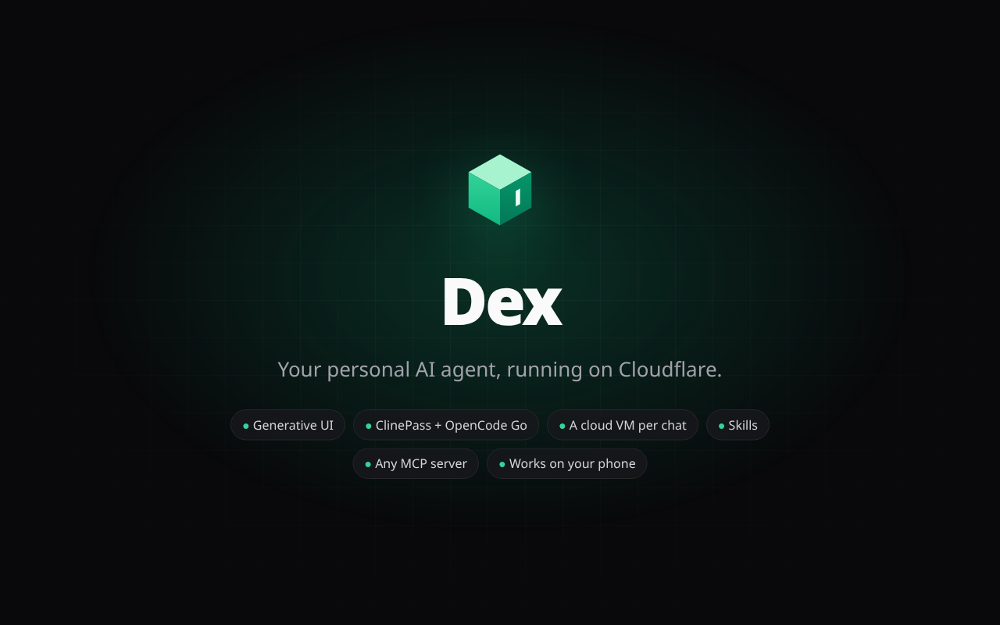
</p>

<p align="center">
  <a href="docs/media/dex-promo.mp4">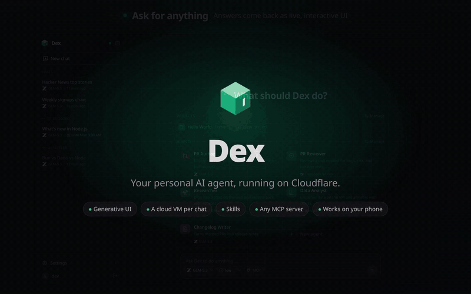</a>
  <br>
  <sub><b><a href="https://trydex.dev">trydex.dev</a></b> · <b><a href="docs/media/dex-promo.mp4">▶ Watch the 2-minute tour</a></b> · generative UI, ClinePass and OpenCode Go, a cloud VM per chat you can watch while you chat, GitHub repos, skills, MCP, usage, and the phone app</sub>
</p>

**Dex** is a personal agent harness. Each user gets an agent in a Cloudflare Durable Object running [Pi Durable](https://developers.cloudflare.com/agents/harnesses/pi/), thinking with models through [ClinePass](https://docs.cline.bot/getting-started/clinepass) or [OpenCode Go](https://opencode.ai/docs/go/), answering with generative UI from [OpenUI](https://www.openui.com/), and doing real work on its own cloud VM from [boat.dev](https://boat.dev). Built with TanStack Start, Effect, and the Cloudflare Agents SDK, and installable on your phone. See it at **[trydex.dev](https://trydex.dev)**, then [deploy your own](#deploy).

[Highlights](#highlights) · [Features](#features) · [Repository](#repository) · [Architecture](#architecture) · [Develop](#develop) · [Deploy](#deploy) · [Security](#security) · [Limits](#limits) · [License](#license)

## Highlights

<table>
  <tr>
    <td width="50%">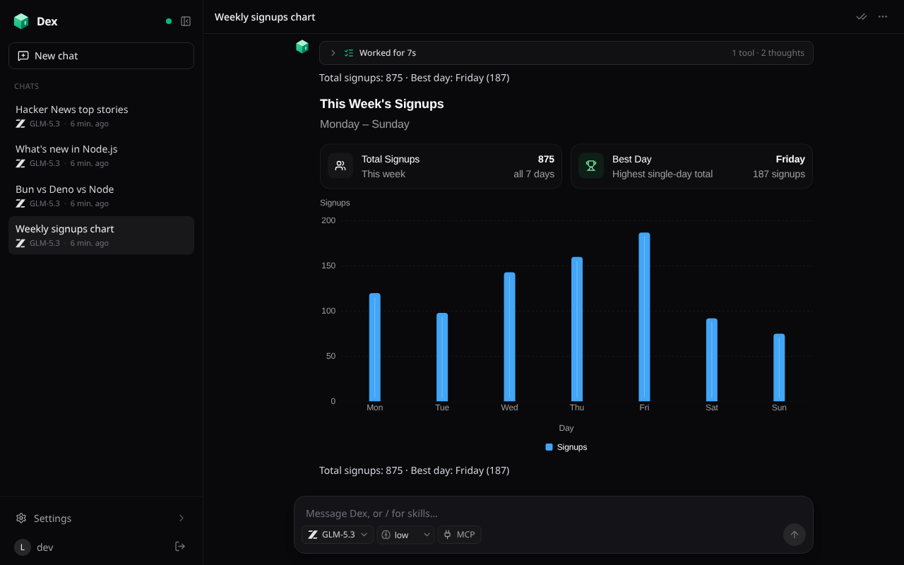<br><b>Answers as live UI.</b> Cards, tables, charts, and forms, streamed as the model writes them.</td>
    <td width="50%">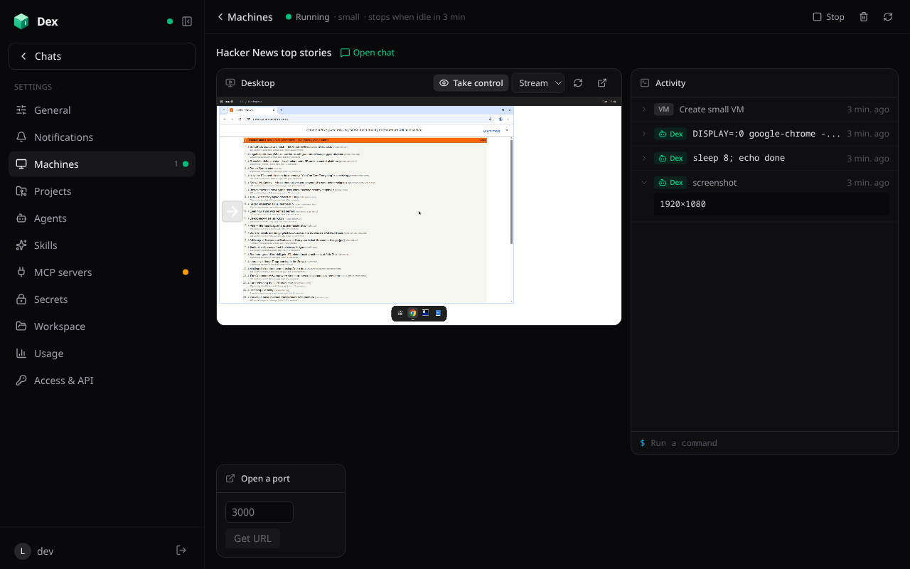<br><b>A cloud VM per chat.</b> Watch the desktop and every command live, or take over.</td>
  </tr>
  <tr>
    <td width="50%">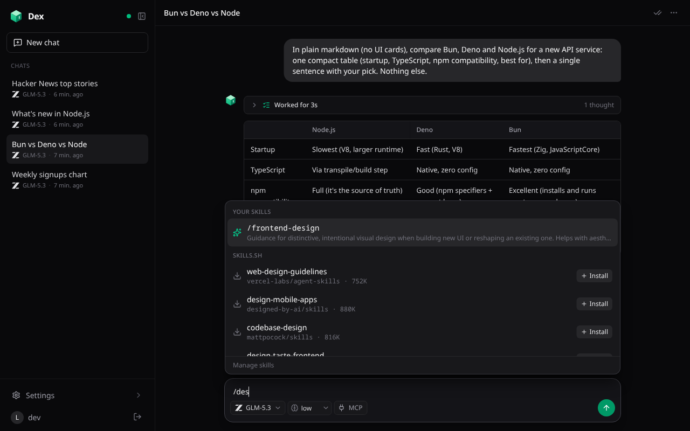<br><b>Skills on a keystroke.</b> Type <code>/</code> to use one, or install it from skills.sh in place.</td>
    <td width="50%">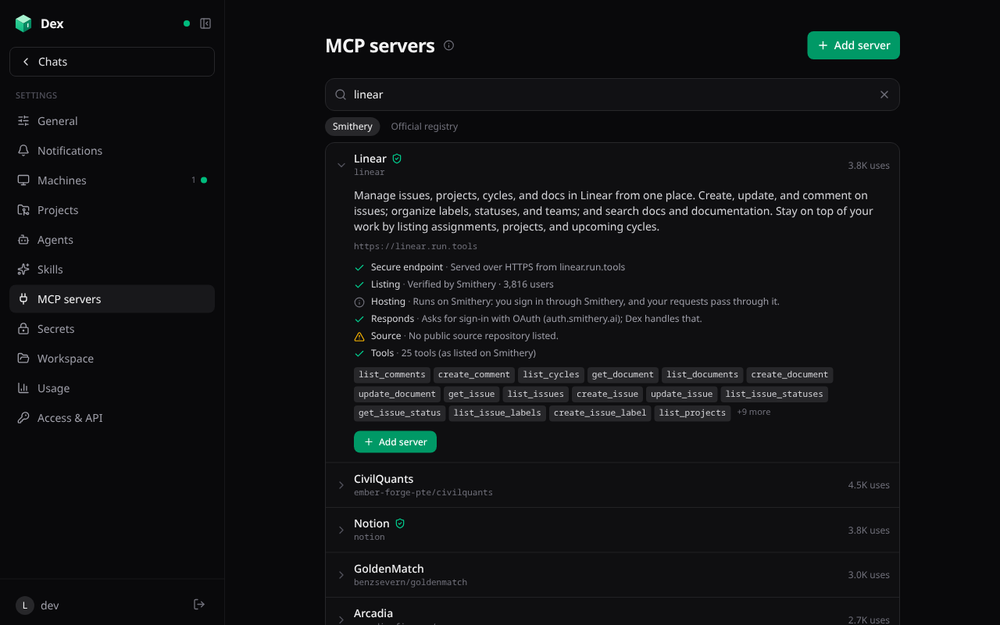<br><b>Any MCP server, checked first.</b> Search, see its tools and sign-in, add it in a tap.</td>
  </tr>
  <tr>
    <td width="50%">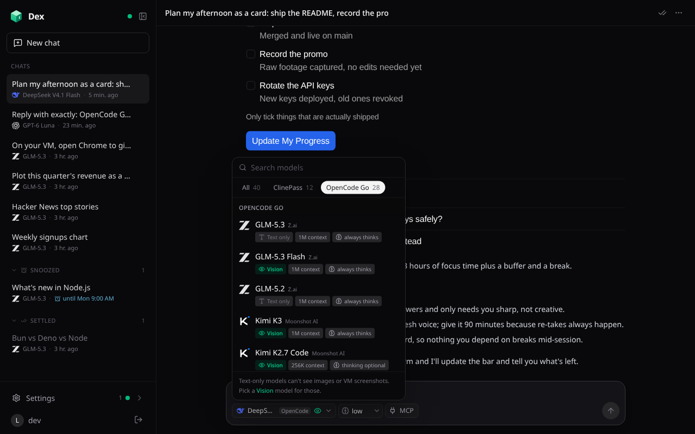<br><b>Two model subscriptions.</b> ClinePass and OpenCode Go, nearly 50 models in one searchable menu that stays current.</td>
    <td width="50%">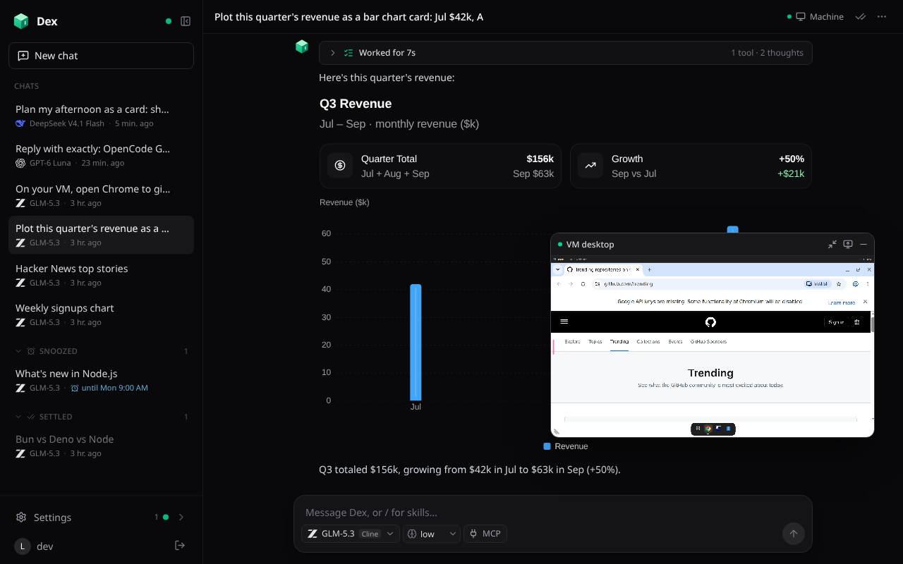<br><b>Watch the VM while you chat.</b> A live picture-in-picture you can drag and resize.</td>
  </tr>
</table>

## Features

### Chat that answers with UI

<table>
  <tr>
    <td width="50%">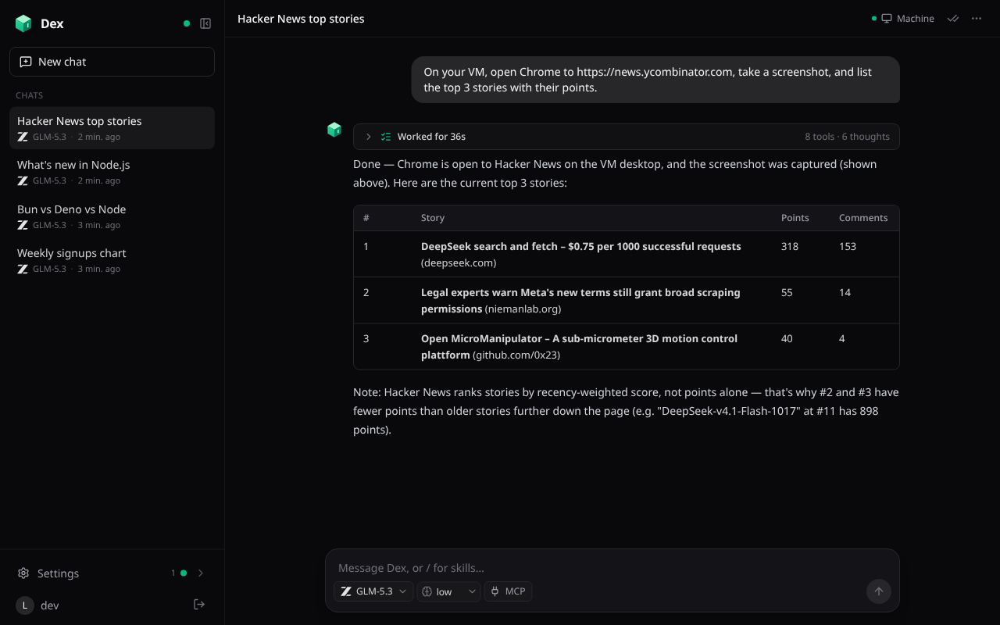</td>
    <td width="50%"></td>
  </tr>
</table>

- **Two model subscriptions, connect either or both:** ClinePass and OpenCode Go (GLM, Kimi, DeepSeek, Qwen, MiniMax, MiMo, Claude Haiku, GPT Luna, Grok, Gemini, and more, each on the API style Go serves it with). Pick a model and thinking level per chat from one searchable menu with All / ClinePass / OpenCode Go tabs; free models and ones whose provider trains on your prompts are marked, and the model button says which subscription it's on. An agent or default on a subscription you haven't connected runs the same model on one you have. The list keeps itself current: each agent checks OpenCode Go's live model list and [models.dev](https://models.dev) at startup and hourly while you're using it (or now, from the menu's refresh button), so new models appear, retired ones drop out, and a chat on a retired model continues on your default one. Replies stream live, and runs survive restarts, evictions, and deploys.
- **One activity row per reply** folds its thinking, tool calls, and in-between notes. While it works it shows what's really happening: the running tool and its arguments ("Running on the VM… npm test"), or the latest line of the model's thinking. Then it reads "Worked for 36s · 8 tools · 6 thoughts"; tap it to see every step. Screenshots in those steps load when you open them, so long VM chats stay light.
- **Generative UI** with `render_ui` (OpenUI): cards, stat tiles, tables, charts, and forms. They work without a round trip to the model: filters, tabs, and toggles keep their own state (saved, so a card opens as you left it), `Query()` shows live Dex data (your chats, VMs, usage, workspace files, and read-only peeks into a chat's running VM: files, git status, ports, processes) that refreshes on its own while the card is on screen, and buttons run app operations with `Mutation()` or open a chat, file, or machine. Live data may only read; anything that deletes or changes settings shows Dex's own description of it to confirm first, button actions appear in the Access page's activity, and the chat hears what you did with its UI along with your next message. A UI with mistakes offers **Fix it**, and **Pin to board** keeps any card as a live panel on the **Board** page. Markdown tables wrap at word boundaries and scroll sideways in their own frame on a phone.
- **Tools:** `bash` over a persistent `/workspace` (a simulated shell with grep, sed, jq, sqlite3, curl), file tools, `web_search` / `web_fetch` (Workers AI), `schedule_prompt` (one-off or cron), and `use_skill`.
- **Memory:** `/workspace/MEMORY.md` joins every chat's system prompt; edits to it are always shown in the chat.
- **Workspace page:** browse and edit the agent's files, with Markdown rendered and HTML previewed live (scripts run, and libraries, fonts, and images load from anywhere, so CDN charts work), plus an Edit tab for the source.
- **Titles:** a chat starts with its first message as its title; tap the title to rename it, or **Regenerate title** in the chat's menu to have a fast model name it from its first and latest messages.
- **Pinned to the latest message:** chats open at the bottom and follow new content, and a round arrow jumps back down when you've scrolled up.

### A cloud VM for every chat

<table>
  <tr>
    <td width="50%"></td>
    <td width="50%"></td>
  </tr>
</table>

- A chat gets its own Ubuntu VM ([boat.dev](https://boat.dev): root, Docker, Node, Bun, Python, Chrome, and a desktop) the first time the model needs one. Plain questions never start one.
- **Tools:** `vm_exec` (output streams live), `vm_computer` (click, type, press keys, scroll, or drag on the desktop and get a fresh screenshot back in the same call, with coordinates in the screenshot's own pixels), `vm_screenshot` (one request, captured with ffmpeg), with only the newest 3 screenshots sent to the model each step so long computer-use runs stay fast, `vm_read_file` / `vm_write_file`, `vm_expose_port` (token-protected URLs), `share_media`, `vm_stop`.
- **The Machine page** shows the live desktop and every command as it happens. Take control of the desktop, run your own commands, open ports, re-run setup, or stop the agent mid-run to take over.
- **Watch while you chat:** while a chat's VM runs, a small floating button opens a picture-in-picture window of its live desktop. Drag the button or the window anywhere, resize the window from a corner (it stays 16:9), and both stay where you leave them. It's for watching, and closing it stops the stream; the Machine page is where you take control.
- **The desktop streams three ways:** boat's Stream player (Chrome), [Selkies](https://github.com/selkies-project/selkies) (H.264 over a WebSocket, decoded by WebCodecs, so it plays on iPhone and iPad too, and the default wherever Stream can't play), or noVNC. Selkies' client ships with Dex and the stream is relayed by the Worker, which adds the VM's port cookie and password, so neither reaches the browser.
- **VM template:** Dex saves a prepared disk in your boat account (a named snapshot with the desktop stream installed, built on a throwaway VM without your credentials, rebuilt monthly), and new VMs start from it, ready in seconds. Until it exists, a VM installs the stream the first time you open its desktop.
- **Lifecycle:** a VM stops after 5 idle minutes (configurable) and keeps its disk. It's deleted with its chat, and Dex retries every 5 minutes if boat.dev can't be reached then. Requests retry when Cloudflare can't connect, and when boat refuses another running VM, Dex stops the least recently used idle one.
- **Your own boat.dev account:** everyone connects their own boat.dev key in Settings → Cloud VMs (checked, then stored encrypted). The deployment's `BOAT_API_KEY` serves only its owner.

### Skills

<table>
  <tr>
    <td width="50%">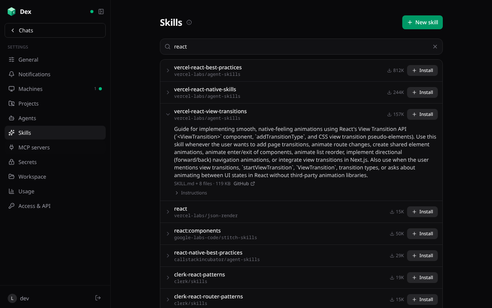</td>
    <td width="50%"></td>
  </tr>
</table>

- Skills are instructions for particular tasks: a `SKILL.md` and the files beside it. Install them from [skills.sh](https://skills.sh), or write your own on the Skills page.
- **Typing `/` in any message** opens a quick lookup of your skills and skills.sh matches, which install in place. A message starting with `/<name>` adds that skill's instructions to the chat from then on.
- **Auto skills** are listed for every chat, which loads one with `use_skill` when a request matches.
- Installing reads the skill from its GitHub repo, using your GitHub connection for private repos and a higher rate limit. Text files only, up to 60 files and 1 MB. Expand a search result to read it before installing.

### MCP servers: remote, local, searched, and checked


- **Remote servers** (Streamable HTTP or SSE) with no auth, headers (encrypted at rest), or OAuth (dynamic client registration with PKCE; the Agents SDK stores and refreshes tokens). Each server's tools appear as `<server>__<tool>`. Chats pick servers in the composer, agents preselect theirs, and servers marked "On for new chats" attach to plain new chats.
- **Search** [Smithery](https://smithery.ai) by default: it answers in well under a second, with use counts and verification, and its servers sign in through Smithery. Or search the official [MCP Registry](https://registry.modelcontextprotocol.io) for publishers' own endpoints and packages.
- **Checks before you add one:**
  - HTTPS.
  - The verified publisher, and whether the endpoint is on their domain.
  - A live MCP handshake (open, OAuth, or a required header) and its tool list.
  - Its GitHub repo: stars, license, archived, last push.

  "Add server" opens the editor prefilled.
- **Local (stdio) servers:** npm, PyPI, and Docker packages, or any command, run on a dedicated "MCP servers" VM. Each runs behind [supergateway](https://github.com/supercorp-ai/supergateway) (stdio to Streamable HTTP, one port each), and Dex connects to its private address like any remote server.
  - The VM starts when a chat calls one of the server's tools, tool calls keep it awake, and it stops when idle.
  - The MCP VM never gets your GitHub token or saved secrets. Each server gets only the environment variables it lists.

### Queue, edit, and steer follow-ups

- Messages you send while a chat is working wait in a collapsible panel above the message box.
- Open the panel to edit, reorder, or delete them, or **Steer** one into the current run after its current step.
- One message goes each time a run ends. Stopping a chat holds the queue until you send something.

### Inbox triage

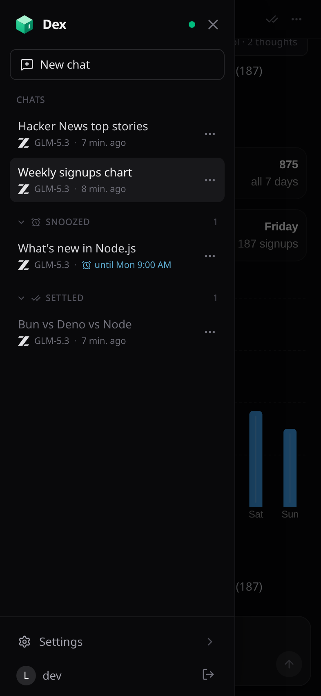

- The chat list works like an inbox. **Settle** a chat when you're done for now and it moves under a collapsed Settled group.
- **Snooze** a chat (in an hour, this evening, tomorrow, this weekend, next week) and it waits under Snoozed, then comes back to the top at that time with a notification.
- Any new message in a chat brings it back to the inbox.
- On a phone, **long-press a chat** in the sidebar for its menu (regenerate the title, settle, snooze, delete), which frees the row's room a ⋯ button would take; on a computer, right-click or use the ⋯ that appears on hover.

<br clear="right">

### Secrets

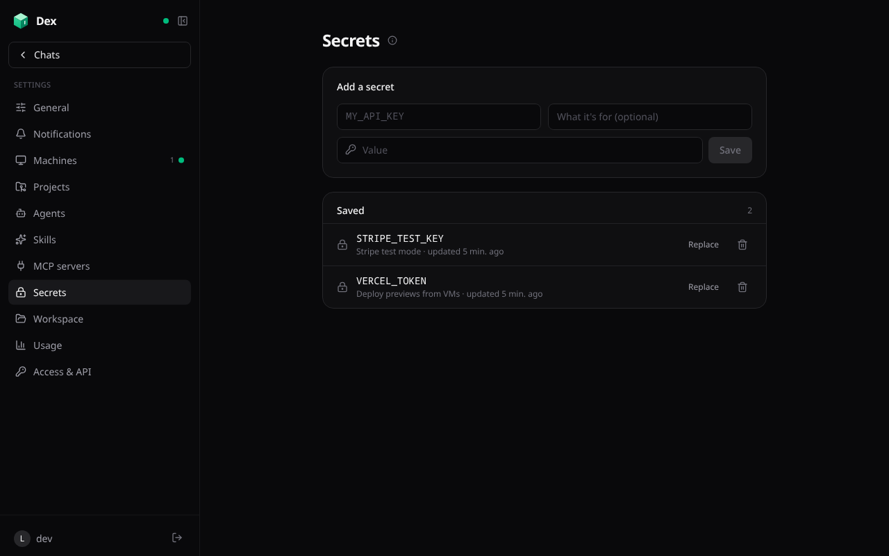

- **Saved secrets** (Settings → Secrets) are API keys every chat's VM gets as environment variables. Enter them once, and the model uses `$NAME` without ever seeing the value.
- They're written to a private env file on each VM, loaded by every command, by login and interactive shells, and by project setup scripts. VMs pick up changes on their next command.
- **Password fields in chat forms** keep the value out of the transcript. The browser stores it, encrypted per chat, before sending, and the message carries `{{secret:name}}`. VM tools fill placeholders in on the VM, as environment variables from a file the command sources and deletes.
- Any secret value in VM output, read files, or the Machine page's log is masked before the model or you see it.

### Projects, GitHub, and agents

<table>
  <tr>
    <td width="50%">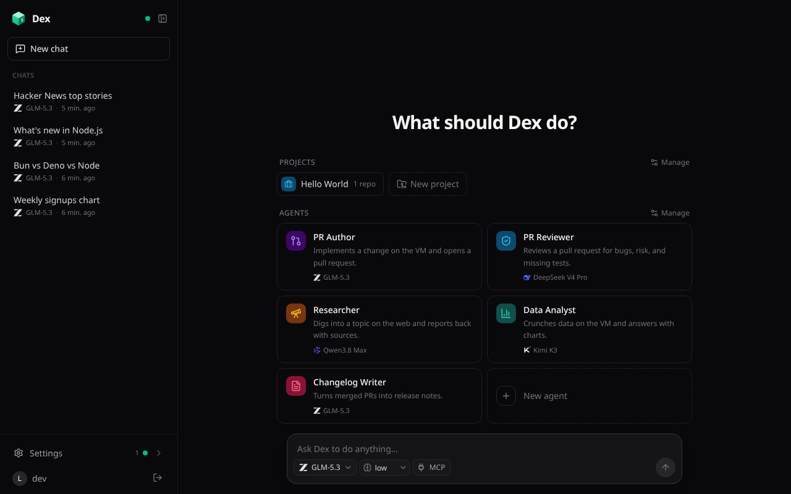</td>
    <td width="50%">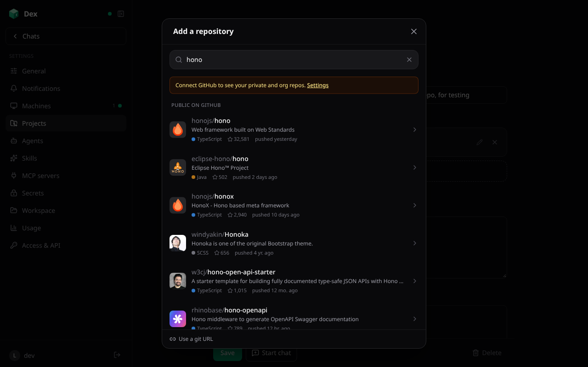</td>
  </tr>
</table>

- **Projects:** one or more repos (with branch and folder), a setup script, notes for the model, a starter prompt, a VM size, and a picture: Dex looks through the first GitHub repo for its favicon, app icon, and logo files (and offers the owner's avatar), and the one you pick replaces the project's icon everywhere.
  - **Add repository** opens a sheet that searches every repo your GitHub connection can reach, private and org ones included, then public repos, with owner filters, avatars, language, stars, and last push. Pick one, then its branch (filterable) and folder, or paste any git URL. If GitHub revokes the connection, Dex says so, offers Reconnect, and falls back to public repos.
  - Starting a project chat boots its VM, signs in to GitHub, clones the repos into `~/work`, and runs the setup script before the model's VM tools go ahead.
- **GitHub:** Connect with GitHub (OAuth) or paste a fine-grained token. Every new VM signs the GitHub CLI and git in with it, so agents can push and open pull requests. Disconnecting an OAuth connection revokes the token at GitHub.
- **Custom agents:** presets with a name, icon, color, instructions, starter prompt, model, thinking level, and MCP servers. Dex starts with PR Author, PR Reviewer, Researcher, Data Analyst, and Changelog Writer, and agents combine with projects.

### Inline media

- Videos, audio, and images a chat makes on its VM play inline with `share_media`. Dex stores them privately in R2, with seeking (byte ranges, which Safari needs), and deletes them with their chat.
- Media is never played from a VM: when a reply links a file served from its VM's port, Dex copies it into the chat when the reply ends, or when you tap "Save to chat".
- YouTube, Vimeo, and direct video links render as players that load only when you tap play.

### On your phone

<table>
  <tr>
    <td width="50%">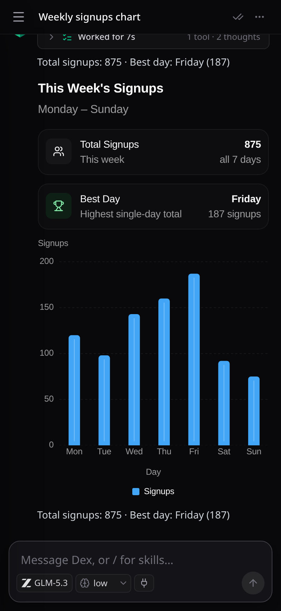</td>
    <td width="50%">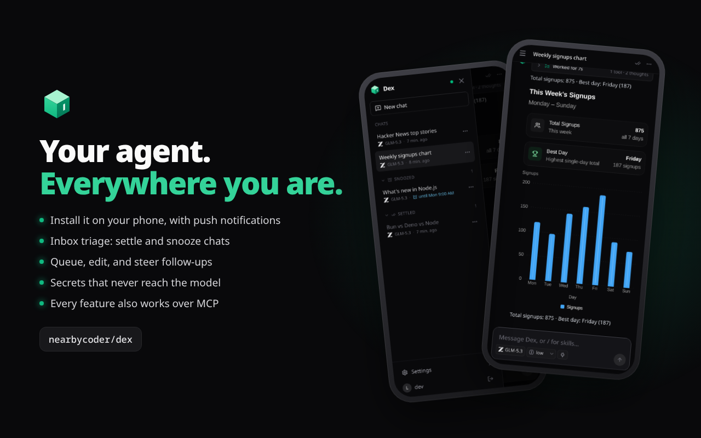</td>
  </tr>
</table>

- **Install it** on a phone or tablet Home Screen. It runs full screen and edge to edge, keeps the composer above the keyboard, and opens the sidebar with a swipe from the left edge (never "back"). It adapts from folded phones to tablets. When a new version is deployed, **Update ready** appears at the bottom of the sidebar (with a dot on the menu button) for a one-tap refresh, and the app reloads by itself when you come back to an idle chat after a while.
- **Push notifications** (opt in, per device) for replies, errors, scheduled prompts, machine setup, MCP sign-ins, and snoozed chats coming back. A chat that's open on any device stays quiet, and each chat has a mute bell. Android and desktop notifications carry quick actions; iOS 16.4+ delivers them to the installed app.
- **Haptics** on every control you tap (buttons, links, menus, switches, tabs) and on swiping the sidebar. iPhone has no Vibration API, so Dex plays the system tap by clicking a hidden `<input type="checkbox" switch>` during the tap (not by laying switches over buttons, which stops lists from scrolling); Android uses `navigator.vibrate`. Fields never zoom the page on focus.

### Chats and external agents can run Dex

- Every app capability is an operation in one registry (`src/agent/operations.ts`):
  - Chats, agents, projects, skills, MCP servers, VMs, schedules, the workspace, the queue, notifications, settings, and usage.
- **Chats** use them through `app_operations` / `app_call`, so "start a chat per repo and have each open a PR" just works.
- **External agents** connect over MCP at `/api/mcp` with a token from Settings → Access & API. Each token is Read, Read & write, or Full, and has an expiry.
- **Admin operations** (deleting things, settings, editing existing agents or projects, MCP servers, installing skills) need a Full token, or your tap on a Confirm card in the chat.
- Every operation is validated, rate-limited, and logged. `npm run check:ops` (run by `npm run deploy`) fails if a new callable isn't covered or explicitly excluded.

### Usage, speed, and the rest

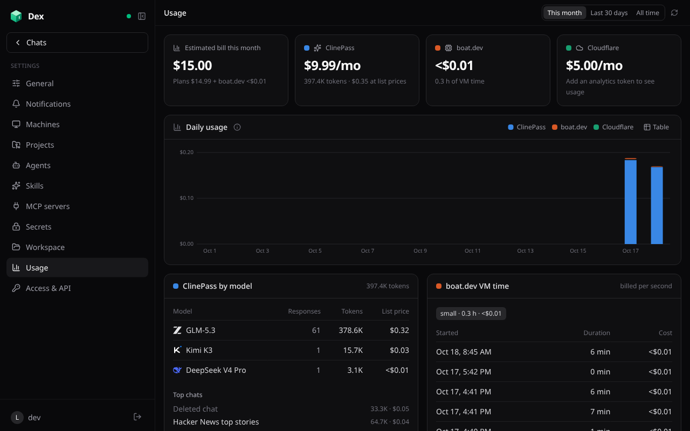

- **Usage:** what Dex costs across ClinePass (tokens per model and chat, at list prices), OpenCode Go (tokens at Go's rates, plus your 5-hour, weekly, and monthly allowance read live from OpenCode), boat.dev (VM time), and Cloudflare (from the Analytics API), with a daily chart.
- **Snappy navigation:** pages render from the agent's synced state, so switching pages never waits on the network.
  - Every page's code is fetched while idle, and the last state, the last sign-in, and the last 8 chats you opened are kept on the device (signing out clears them), so a launch shows them at once while a cold agent wakes; the session is confirmed in the background. The service worker serves the app's shell from its last copy and refreshes it in the background, so a launch doesn't wait on the network (even offline, recent chats open); after a deploy the app moves onto the new build on its own when nothing is typed.
  - Anything still loading shows a skeleton shaped like the page.
  - Opening a chat sends only what the page shows: no system prompt, no screenshots (they load when opened), the UI guide as one line, and long tool outputs cut to their last 12,000 characters, which made snapshots about 85% smaller; live events during a run are slimmed the same way.
  - What you send shows at once, before the agent has recorded it.
  - The agent batches and dedupes the updates it sends.
- **Always current:** after a deploy, the first page load restarts a long-running agent onto the new code.
- **A landing page** at `/` for signed-out visitors shows what Dex does with the app's own screenshots and the tour; signed in, `/` goes straight to your chats.
- **Sign in** with GitHub (allowlisted logins), an owner password, or a local dev login. **Sign out everywhere** revokes every session on every device.

## Repository

A monorepo, so the web app and future native apps live side by side and each deploys on its own:

```
apps/
  web/        the app: TanStack Start UI, the Cloudflare Worker, and the DexAgent Durable Object
              (its own package.json, wrangler.jsonc, and `npm run deploy`)
  ios/        (planned) native iOS app
  android/    (planned) native Android app
packages/     (planned) code shared between apps, e.g. the wire protocol
assets/       brand assets (the app icon source)
docs/         README screenshots and the promo video
```

The root `package.json` is an npm workspace (`apps/web` and `packages/*`). Its scripts forward to the web app, so `npm run dev`, `npm run typecheck`, and `npm run deploy` work from the root; `npm run deploy:web` is the explicit form. A JavaScript app joins by adding its folder to `workspaces`; native apps keep their own tooling (Xcode, Gradle) in their folder and their own release process.

## Architecture

```
Browser (TanStack Start, React)
  │  HTTP: login, server functions          WebSocket: RPC, synced state, Pi event stream
  ▼                                          ▼
Worker (src/server.ts) ── auth check ──► DexAgent Durable Object, one per user (src/agent/dex-agent.ts)
  └─ TanStack Start handler                  ├─ PiHarness → Pi Durable (chats in the object's SQLite)
                                             ├─ ClinePass provider (openai-completions → api.cline.bot)
                                             ├─ OpenCode Go provider (completions, responses, messages, google → opencode.ai)
                                             ├─ tools + Workspace (SQLite-backed files, just-bash)
                                             ├─ VmManager → boat.dev VMs (one per chat, plus the MCP VM)
                                             ├─ MCP client (remote servers; local ones via supergateway)
                                             ├─ Skills, secrets, message queue, media (R2), push
                                             └─ Agents SDK schedules (scheduled prompts, queue checks)
```

In `apps/web/src/`:

- `server/`: Effect services for config, keys (HMAC session signing, AES-GCM), sessions, and GitHub OAuth.
- `agent/`: the Durable Object and its parts (operations, VMs, MCP and registry search, skills, secrets, queue, media, push, the ClinePass and OpenCode Go providers) and the tools.
- `shared/`: model catalog, wire protocol, and shared types.
- `client/`: the agent connection (`useAgent`), the Pi event reducer, and UI components.
- `routes/`: pages and auth endpoints.

## Develop

```sh
npm install                                             # from the root: installs every workspace
cp apps/web/.dev.vars.example apps/web/.dev.vars        # set AUTH_SECRET; DEV_LOGIN=true enables the dev login
npm run dev                                             # http://localhost:5173
```

Workers AI (web search and fetch) runs remotely even in dev, so run `npx wrangler login` first. After changing `apps/web/src/client/openui/library.tsx`, run `npm run openui:spec -w @dex/web` to regenerate the component spec the agent learns from. See [AGENTS.md](AGENTS.md) for the conventions every change follows (operations, skeletons, security, deploys).

## Deploy

The web app deploys to Cloudflare Workers from `apps/web`. `apps/web/wrangler.jsonc` is the same for everyone; your deployment's settings live in the gitignored `apps/web/.deploy.vars`, which `npm run deploy` passes to Wrangler.

1. Create a GitHub OAuth app (github.com/settings/applications/new) with homepage `https://<your-domain>` and callback `https://<your-domain>/auth/github` (sign-in and "Connect with GitHub" use paths under it), where `<your-domain>` is your custom domain or the Worker's workers.dev address.
2. Copy `apps/web/.deploy.vars.example` to `apps/web/.deploy.vars` and set `ALLOWED_GITHUB_USERS` (the first login is the owner), plus `CLOUDFLARE_ACCOUNT_ID` and `VAPID_PUBLIC_KEY` if you use the Usage page and push notifications. For a custom domain, add its zone to your Cloudflare account with a proxied DNS record for the hostname (an `AAAA` record to `100::` works), and set `CUSTOM_DOMAIN` (comma-separated, main one first, e.g. `example.com,www.example.com`): every deploy routes it to the Worker, and pages opened at the workers.dev address (or www) redirect to the main one. The deploy refuses to run without an allowlist.
3. Add the secrets (from `apps/web`), then deploy from the root:

```sh
cd apps/web
npx wrangler secret put AUTH_SECRET
npx wrangler secret put GITHUB_CLIENT_ID
npx wrangler secret put GITHUB_CLIENT_SECRET
npx wrangler secret put CLINE_API_KEY         # optional shared key
npx wrangler secret put OPENCODE_API_KEY      # optional: OpenCode Go key for the owner's chats; everyone else connects their own
npx wrangler secret put OWNER_PASSWORD        # optional: password sign-in as the owner
npx wrangler secret put BOAT_API_KEY          # optional: boat.dev key for the owner's VMs; everyone else connects their own
npx wrangler secret put CLOUDFLARE_API_TOKEN  # optional: Account Analytics: Read, for the Usage page
npx wrangler secret put VAPID_PRIVATE_KEY     # optional: push notifications (a P-256 private JWK; its public key goes in VAPID_PUBLIC_KEY)
cd ../.. && npm run deploy                    # checks operations, builds, and deploys apps/web
```

## Security

- **Sign-in:**
  - GitHub OAuth, for allowlisted logins only and state-checked.
  - The owner password: compared by HMAC, limited to 10 attempts a minute per IP, same-origin posts only.
  - Dev login is off unless `DEV_LOGIN` is set.
- **Sessions:**
  - Signed, HttpOnly, SameSite=Lax, Secure cookies, valid for 30 days.
  - Sign out everywhere revokes every session; every sign-in check rejects older ones and closes their sockets.
  - Each user's agent accepts requests only from the same origin, with a current session for that user.
- **Stored secrets:** API keys, tokens, MCP headers and env values, and saved and chat secrets are AES-GCM encrypted. Nothing secret is synced to the browser or returned by an operation.
- **Secrets and the model:** the model only ever sees placeholders and names. Values reach VMs through files that commands source, and are masked in output.
  - Chat VMs get all saved secrets, so anything a chat installs there could read them.
  - The MCP VM, which runs third-party packages, gets no GitHub token and no saved secrets, only each server's listed variables.
- **Browser:** a strict Content Security Policy:
  - Scripts and connections only to Dex itself (`connect-src 'self'`).
  - Images only from Dex, GitHub avatars, and YouTube thumbnails.
  - Frames only from Dex's own VM desktop page, boat.dev, and the YouTube/Vimeo players. Only that desktop page may be framed, and only by Dex.

  Also COOP same-origin, HSTS, `nosniff`, a strict referrer policy, and a minimal Permissions-Policy. Model output is rendered without raw HTML.
- **VM desktop relay:** `/vm-desktop/<vm>/` serves Dex's own copy of the Selkies page and relays only the stream's WebSocket and Selkies' few API paths to the VM, adding the port cookie and password itself. Anything the VM answers is made inert on Dex's origin (a sandboxing CSP, no redirects, cookies, or CORS headers; files download as attachments), so a VM taken over by a prompt-injected agent can't run script as you. The stream's port is closed to the internet by boat's firewall.
- **Workspace HTML previews:** the page posts the file to `/workspace-preview`, which answers only signed-in, same-origin posts, with the HTML as its own document under a CSP `sandbox` (an opaque origin: no cookies, storage, or requests as you, no top navigation) that only Dex may frame.
- **Media:** served only to its owner, for an allowlist of video, audio, and image types (never HTML, SVG, or PDF), sandboxed. VM uploads use single-use, HMAC-checked tokens.
- **MCP access tokens:**
  - 256-bit secrets bound to their user by an HMAC, checked before any agent wakes.
  - Stored only as SHA-256 hashes.
  - Scoped, expiring, revocable, and rate limited.
- **Prompt injection:** tools run without approval, so text from the web or an MCP server can try to steer a chat. Anything lasting or destructive waits for your Confirm:
  - Deleting things, settings, editing existing agents or projects, MCP servers, skills, and recurring schedules.
  - Chats started by chats go at most two levels deep.
  - Every operation is in the Access page's activity log.

  A tricked chat can still use a secret it has access to in a command, so give chats only the secrets they need.
- **Dependencies:** `npm audit` reports no high or critical issues. KaTeX is pinned to a patched 0.18; the remaining moderate advisory is `sprintf-js` in the simulated workspace shell, with no upstream fix yet.

## Limits

- Cline and OpenCode have no third-party OAuth, so users connect with an API key. OpenCode Go's allowance comes from an endpoint its docs don't list (what its console reads); if it changes, the Usage page says so and tokens are still counted.
- The `/workspace` shell is simulated (just-bash) and can't install or run programs; real work happens on a VM.
- boat.dev's free trial allows 2 running VMs at once; stopped VM disks are kept 14 days.
- boat's Stream player needs Chrome; other browsers (every iPhone and iPad browser) use Selkies. The Selkies desktop keeps the VM's screen size (the agent's screenshots and clicks depend on it) and scales the picture to fit.
- `web_search` needs Web Search billing on the Cloudflare account.
- Pi Durable has no tool-approval step yet and can't delete conversations, so deleting a chat hides it.
- The official MCP Registry can take many seconds for a search it hasn't cached; Smithery is the fast default.

## License

[MIT](LICENSE)

The Selkies web client in `apps/web/public/assets/selkies` is unmodified from its 2.0.0 release and is under the [Mozilla Public License 2.0](apps/web/public/assets/selkies/LICENSE.txt).
